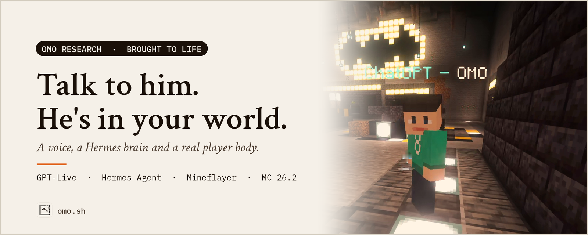
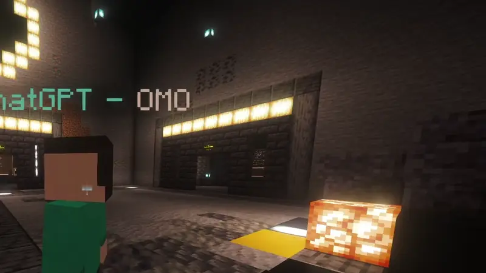
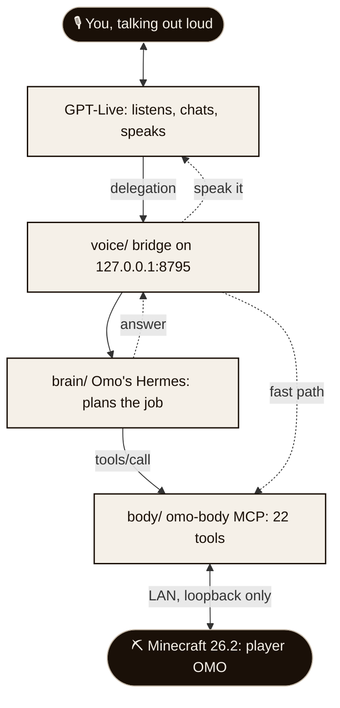
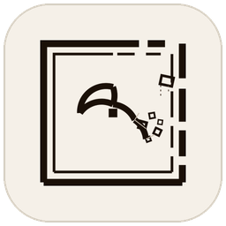

<p align="center">
  
</p>

<h1 align="center">Omo, brought to life</h1>

<p align="center">
  Not a chatbot in a side window. <b>Omo</b> is a player in your Minecraft world:<br>
  you talk to him out loud, he answers in his own voice, and then he actually goes and does it.
</p>

<p align="center">
  <a href="https://github.com/omoresearch/omo-brought-to-life/releases/latest"><b>Download v0.1.0</b></a>
  &nbsp;·&nbsp;
  <a href="#quick-start">Quick start</a>
  &nbsp;·&nbsp;
  <a href="#how-it-works">How it works</a>
  &nbsp;·&nbsp;
  <a href="https://www.omo.sh">omo.sh</a>
</p>

<p align="center">
  <a href="https://github.com/omoresearch/omo-brought-to-life/releases/latest"></a>
  
  
  
  
  
</p>

---

<table>
<tr>
<td width="50%"></td>
<td width="50%"></td>
</tr>
<tr>
<td align="center"><sub><b>"Follow me."</b> He keeps up through the Batcave and up the stairs, on his own legs.</sub></td>
<td align="center"><sub><b>He is really there.</b> A player entity with a body, a skin and a name tag. Not an overlay.</sub></td>
</tr>
</table>

<p align="center"><sub>Real gameplay from the 27 October 2026 live stream: cropped, crosshair removed, nothing staged or generated.</sub></p>

## What Omo is

At [Omo Research](https://www.omo.sh) we build agents that are **present**:
they have a body, a place and a voice. Omo is the first one we brought all the
way to life.

- **A body.** Omo logs into your single-player world as a real player
  (`ChatGPT - OMO`, with his own skin). He walks, jumps, swims, takes knockback,
  gets hungry, fights and sleeps. Other mobs see him as a player, because he is one.
- **A place.** He lives where you play. He sees the blocks, mobs and players
  around him, carries an inventory, and works the same crafting tables, furnaces
  and chests that you do.
- **A voice.** Press "Start talking" and just speak. GPT-Live listens and
  answers in real time, full duplex, in Omo's own voice (a warm old grandad).
  When you ask for something real, a Hermes agent plans it and drives his body.

Here is one real exchange from the bridge log (two requests, overlapping,
both answered):

```text
player said: Hey Omo, can you use Hermes to look up what the Prismarine Viewer plugin does
omo said:    Sure, hang on.
player said: Oh and also, what do you have in your inventory right now
omo said:    Checking that too, just a sec.
hermes (12s) -> I checked its official README: Prismarine Viewer lets you watch a Minecraft bot's surroundings live in a web browser...
hermes (8s)  -> I've got four pieces of rotten flesh and nothing else. Not exactly a gourmet picnic.
omo said:    Right, Prismarine Viewer is like a live spectator camera for a bot. You can watch what
             it sees in your browser, and I've got four pieces of rotten flesh. Not exactly a gourmet picnic.
```

## What he can do

These are the 22 tools his body serves to Hermes (MCP server `omo-body`). Every
one returns a short fact he can say out loud. The long ones run as **jobs**:
walking somewhere cancels a job, a monster pauses it (he fights, then carries
on), and anything longer than a minute keeps going in the background and he
posts in chat when it is done.

| | Tool | What he does |
|---|---|---|
| **See** | `body_state` | Where he is, health, food, biome, time, nearby players, blocks and mobs, inventory, armour, current job |
| | `body_craftable` | Lists what he can craft right now from his inventory |
| **Move** | `body_come_to` | Walks to you and stops at your side. Too far to walk? He teleports to you (`/tp`, cheats on) |
| | `body_follow` | Follows you until told to stop, and comes back to following after a job |
| | `body_stop` | Stops everything: walking, following, chopping, crafting |
| | `body_go_to` | Walks to block coordinates |
| | `body_go_to_block` | Walks to the nearest block of a type: a chest, water, a crafting table, a tree |
| | `body_look_at` | Turns to face you |
| **Fight** | `body_guard` | Guard mode (on by default): stays with you and attacks any hostile mob within 16 blocks of you |
| | `body_attack` | Attacks the nearest monster now, on the real attack cooldown |
| | `body_hunt` | Hunts the nearest mob of a type: a cow, a pig, a zombie |
| **Work** | `body_collect` | Chops trees and mines blocks and ores with the right tool, then picks up the drops |
| | `body_craft` | Crafts items, using or placing a crafting table. Missing ingredients come back by name |
| | `body_smelt` | Smelts in a nearby furnace, or places one |
| | `body_place` | Places a block at coordinates or in the nearest free spot |
| | `body_chest` | Puts items into, or takes them out of, the nearest chest |
| | `body_pickup` | Picks up dropped items nearby |
| | `body_give` | Walks over and tosses you items |
| | `body_equip` | Holds a tool or weapon, or wears armour |
| **Live** | `body_eat` | Eats the best food he has (he also eats by himself when hungry) |
| | `body_sleep` | Goes to the nearest bed at night |
| | `body_chat` | Types in the game chat, for coordinates or lists you should read |

**Reflexes he has without being asked:** he fights back, backs off and eats
when his health is low, jumps out of lava, fire and deep water, puts on the
best armour he picks up, eats when hungry, looks at whoever hits him, and takes
real knockback. "Come here", "follow me", "stop", "fight" and "chop some wood"
take a fast path straight to his body, so they never wait on a language model.

**Hermes plans the rest.** "Make me a stone sword" becomes: collect wood, craft
planks, sticks, a crafting table and a wooden pickaxe, mine stone, craft the
sword, equip it. On stream he ran that whole chain himself, including retrying
a craft that failed the first time.
Because his brain is a full Hermes agent, he can also do real work off-world
when you ask: look something up, read a file, check a project.

## How it works



1. **Voice** (`voice/`). The page opens a WebRTC call to GPT-Live. The bridge
   creates the call with your ChatGPT login (through Hermes' `openai-codex` auth)
   and joins its sideband. GPT-Live chats on its own; when you ask Omo to *do*
   something, it emits a **delegation**.
2. **Brain** (`brain/`). The bridge hands each delegation to Omo's own Hermes
   profile. Hermes plans with the `omo-body` skill and calls body tools until
   the job is done. Requests that arrive mid-job are queued, and every answer
   goes back to the newest delegation so GPT-Live always says it.
3. **Body** (`body/`). A Mineflayer bot named `OMO` joins your world over LAN
   and serves its actions as an MCP server at `/mcp`. Its skills are
   [Mindcraft](https://github.com/mindcraft-bots/mindcraft)'s library, wrapped
   in jobs that can be interrupted, paused for a fight and resumed.
4. **Mod** (`mod/`). Four small changes to the Omo Space mod open your
   single-player world to LAN for local agents only, let a plain client join a
   Fabric world, and give agents the Omo skin and the `ChatGPT - ` name tag.

More detail: [docs/how-it-works.md](docs/how-it-works.md).

## Quick start

You need **Linux** (tested on x86_64), **Node 22+**, **Minecraft Java 26.2**
with the [Omo Space](https://github.com/omoresearch/omo-space) mod plus the
patches in [`mod/`](mod/), **[Hermes Agent](https://hermes-agent.nousresearch.com/docs)**,
and a **ChatGPT subscription** whose account can use GPT-Live voice.

**1. Install**

```bash
git clone https://github.com/omoresearch/omo-brought-to-life ~/omo-brought-to-life
cd ~/omo-brought-to-life
npm install          # also teaches Mineflayer Minecraft 26.2 (body/patch-mc-26.2.mjs)
npm test
```

**2. Give him a brain**

```bash
scripts/setup-brain.sh                         # creates ~/.omo-hermes (never overwrites)
HERMES_HOME=~/.omo-hermes hermes auth          # log in with ChatGPT (provider openai-codex)
HERMES_HOME=~/.omo-hermes hermes model         # pick a model your plan offers
```

**3. Give him a place.** Build the Omo Space mod with the patches in
[`mod/patches/`](mod/patches/), start the game and load a world. The mod
publishes it to LAN on port 25566 for local agents and writes
`~/.config/omo/lan.json`.

**4. Bring him to life**

```bash
scripts/start.sh
# open http://127.0.0.1:8795 and press "Start talking"
```

Then say *"Hey Omo, come here."* He joins as `ChatGPT - OMO` within a few
seconds of the world opening.

<details>
<summary><b>Configuration (environment variables)</b></summary>

| Variable | Default | Meaning |
|---|---|---|
| `OMO_LIVE_PORT` | `8795` | Voice page, API and `/mcp` (always bound to 127.0.0.1) |
| `OMO_LIVE_VOICE` | `ember` | arbor, breeze, cove, ember, juniper, maple, sol, spruce or vale |
| `OMO_LIVE_MODEL` | `gpt-live-1-codex` | GPT-Live model on the ChatGPT route |
| `OMO_LIVE_HERMES_URL` | `http://127.0.0.1:8644/v1` | Omo's Hermes API server |
| `OMO_LIVE_HERMES_KEY` | `API_SERVER_KEY` in `$OMO_HERMES_HOME/.env` | Its bearer key |
| `OMO_HERMES_HOME` | `~/.omo-hermes` | Omo's Hermes profile |
| `OMO_LIVE_CODEX_HOME` | `$OMO_HERMES_HOME` | Hermes home whose ChatGPT login the bridge uses (`scripts/start.sh`) |
| `OMO_LIVE_ALLOWED_ORIGINS` | none | Extra page origins, e.g. your tailnet HTTPS URL |
| `OMO_BODY` | on | `0` runs voice only, without a body |
| `OMO_BODY_NAME` | `OMO` | His username (must be in the mod's `omo.agents.names`) |
| `OMO_BODY_GUARD` | on | `0` starts him with guard mode off |
| `OMO_BODY_GAMEMODE` | survival | `keep` stops him switching himself to survival |
| `OMO_BODY_TELEPORT` | on | `0` never uses `/tp` to reach you |
| `OMO_BODY_JOB_WAIT_MS` | `60000` | How long a tool call waits before a job goes to the background |
| `OMO_LAN_FILE` | `~/.config/omo/lan.json` | Where the mod writes the world's LAN port |
| `OMO_LIVE_DEBUG` | off | `1` logs every sideband event |

Mod side (JVM flags): `-Domo.agents.lan=false` turns LAN publishing off,
`-Domo.agents.port=25566` sets the port, `-Domo.agents.names=omo,teacher` lists
agent usernames, `-Domo.agents.allowRemote=true` also admits unauthenticated
players from your network (off by default).
</details>

## Verified

Run against this exact tree for v0.1.0 (Linux x86_64, Node 22):

| Suite | What it covers | Result |
|---|---|---|
| `voice/server.test.mjs` | session, ChatGPT headers, call ids, delegation parsing, 500-byte appends, Hermes request, newest-delegation delivery and queueing | **7/7 pass** |
| `body/body.test.mjs` | LAN file, MCP initialize / tools/list / tools/call, readable errors before a world opens, follow, fast-path movement / combat / wood intents, jobs pausing for a fight and resuming | **8/8 pass** |
| `test/hygiene.test.mjs` | no tokens or machine paths in the tree; this README's abilities table matches the served tools | **3/3 pass** |

Seen working live on stream (27 October 2026, from the bridge log): wood to
planks to sticks to a crafting table to a wooden pickaxe to stone to a stone
sword, equipped; following through the Batcave; two overlapping voice requests
answered in one reply (above).

## Honest limitations

- **The voice route is your own ChatGPT login.** The bridge reads the ChatGPT
  (Codex OAuth) token that `hermes auth` stores, and calls the same realtime
  endpoint the Codex app uses for GPT-Live. It is not a documented public API:
  it can change or break without notice, it needs a plan with GPT-Live access,
  and usage counts against your subscription. A 403 means the account, model or
  voice was refused. Use it for yourself; do not run it as a service for others.
- **No OpenAI API key path yet.** The standard Realtime API (`OPENAI_API_KEY`)
  uses function tools instead of delegations, and is not wired up in this
  release. PRs welcome.
- **Talk through a browser tab.** The mic lives in the local page (WebRTC).
  In-game push-to-talk (Simple Voice Chat) is not wired up for Omo yet.
- **Minecraft 26.2 is newer than released Mineflayer.** `npm install` patches
  in 26.2 data from open upstream PRs. Multi-item crafts desync on 26.2, so he
  crafts one batch at a time (slower but correct).
- **Jobs can come up short.** On stream, a request for 8 birch logs finished
  with 1 collected (trees nearby ran out of reach). He reports the real count,
  so Hermes has to notice and retry; long gather-then-craft chains are the
  weakest part today.
- **In creative mode, digging drops nothing**, so he switches himself to survival
  (needs LAN cheats on, which also enables `/tp`).
- **The skin is client-side.** An offline bot has no Mojang skin; the mod paints
  the Omo skin on your client only.
- **The mod part is a patch, not a standalone mod.** It applies to the Omo Space
  mod source ([`mod/`](mod/)). Hermes replies take a few seconds (8 to 12 s in
  the log above), so GPT-Live says "on it" first.

## Repository

```text
voice/   GPT-Live bridge: server.mjs, the talk page, codex_token.py (+ tests)
body/    Omo's Mineflayer body, the omo-body MCP tools, vendored Mindcraft skills, 26.2 patcher (+ tests)
brain/   Omo's Hermes profile: persona, omo-body skill, config.example.yaml
mod/     The Omo Space mod changes: git patches + the changed sources and skin
scripts/ setup-brain.sh, start.sh
docs/    how-it-works.md, media (hero source: docs/media/make_hero.py)
test/    hygiene tests
```

## Credits

Omo's body skills are [Mindcraft](https://github.com/mindcraft-bots/mindcraft)'s
library (MIT), running on [Mineflayer](https://github.com/PrismarineJS/mineflayer)
and the PrismarineJS stack (MIT). The GPT-Live wire contract follows
[OpenClaw](https://github.com/openclaw/openclaw)'s implementation. The brain is
[Hermes Agent](https://github.com/NousResearch/hermes-agent) by Nous Research.
Full list in [THIRD_PARTY_NOTICES.md](THIRD_PARTY_NOTICES.md). Built by
**[Omo Research](https://www.omo.sh)**. Code is [MIT](LICENSE).

**NOT AN OFFICIAL MINECRAFT PRODUCT. NOT APPROVED BY OR ASSOCIATED WITH MOJANG OR
MICROSOFT.** Not affiliated with or endorsed by OpenAI. ChatGPT and GPT are
trademarks of OpenAI.

<p align="center">
  <a href="https://www.omo.sh"></a>
  <br><sub><i>The next interface isn't a chat window.</i> · Omo Research · <a href="https://www.omo.sh">omo.sh</a></sub>
</p>
